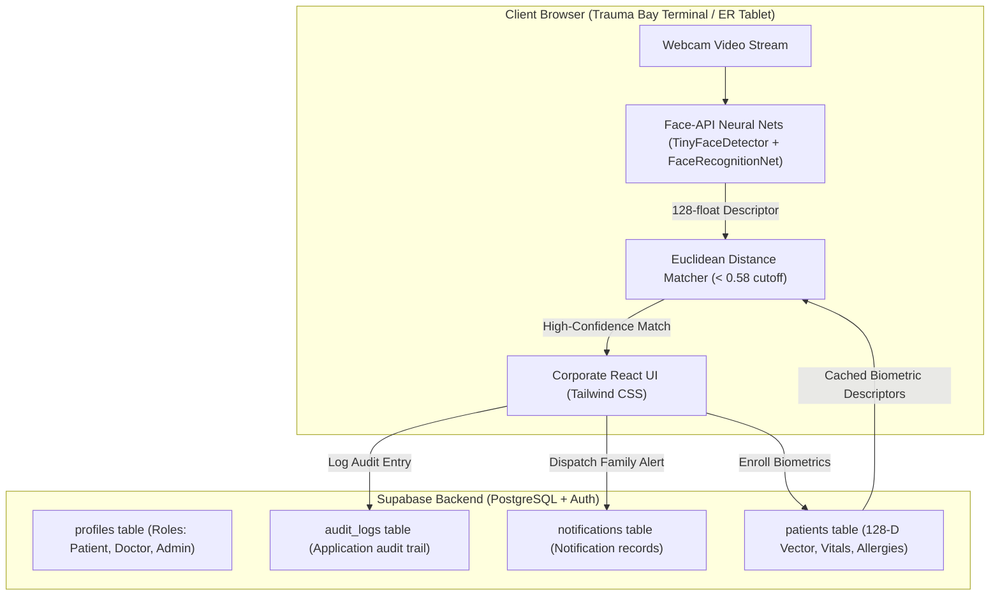

# MED ID — Emergency Biometric Health System
> **"Unconscious Patient. Identified in 3 Seconds."**  
> An emergency biometric health application engineered for ER trauma bays and paramedics to identify unresponsive patients via facial recognition, instantly retrieve life-saving medical history (blood group, anaphylaxis risks, DNR directives), and notify loved ones in seconds.

---

## ⚡ Live Hackathon Demo Walkthrough (3-Minute Script)

### Step 1: Connect Supabase
1. Run the app: `http://localhost:5173/`
2. Click **"Connect DB"** on the top navigation bar.
3. Paste your **Supabase Project URL** and **Anon Key**.
4. Open your [Supabase Dashboard](https://supabase.com/dashboard) > **SQL Editor**, and paste the contents of `supabase_schema.sql` (also available via the **"Copy SQL Schema"** button in the app setup dialog).
5. Click **"Save & Apply"**. The status pill will turn **Green (Supabase Live)**.

The SQL script is also an upgrade script for the earlier demo tables. It creates the app's `descriptor`, `audit_logs`, and `notifications` schema, migrates existing profile accounts, and restricts patient record reads to the patient, an active doctor, or an admin. Promote the first admin manually in SQL Editor, for example: `UPDATE public.profiles SET role = 'admin', status = 'active' WHERE email = 'your-admin-email';`. New doctor accounts remain pending until an admin approves them.

### Shared patient medical history

The patient portal, doctor scan dossier, and admin dossier show the same scrollable medical-history table. Existing blood type, allergy, condition, and medication profile values appear as current rows. Only active doctors and administrators can add clinical entries; each doctor entry is stamped with the doctor's license number and hospital from their account. Patient accounts can edit basic identity and emergency-contact details, but cannot alter clinical records. The table can be exported as CSV. For an existing deployment, run the updated `supabase/medical_history_migration.sql` in the Supabase SQL Editor; a fresh setup can use the updated `supabase_schema.sql`.

Doctor sign-up requires a license number and hospital name. Admin access is provisioned by an existing project administrator: update one trusted account in Supabase SQL Editor with `UPDATE public.profiles SET role = 'admin', status = 'active' WHERE email = 'admin@example.com';`, then sign in again. The application routes that account to the Admin Operations dashboard, where admins can review patient dossiers, doctor accounts, notifications, and audit activity.

If signup returns HTTP 500, run `supabase/repair_auth_signup.sql` in the Supabase SQL Editor to replace the common legacy `on_auth_user_created` trigger with MED-ID's current profile trigger. If it still fails, inspect the matching **Auth** and **Postgres** entries in the Supabase Logs; Auth 500 errors commonly come from database triggers or constraints.

### Deploy the web app to Vercel

1. Push this project to a Git provider and import the repository in Vercel, or run `npx vercel` from this folder.
2. Use the Vite defaults: build command `npm run build` and output directory `dist`. The included `vercel.json` configures these values and rewrites app routes to the SPA entry point.
3. Add `VITE_SUPABASE_URL` and `VITE_SUPABASE_ANON_KEY` in Vercel **Project Settings → Environment Variables** for Production (and Preview if needed). The same names are listed in `.env.example`. Redeploy after changing environment variables.
4. In Supabase **Authentication → URL Configuration**, add the Vercel production URL and any preview URLs to the allowed site/redirect URLs.
5. Deploy with `npx vercel --prod` if using the CLI. Vercel builds the static app; Supabase Edge Functions remain deployed to Supabase.

### Deploy server-verified device credentials

1. Install the Supabase CLI and link this folder to your Supabase project.
2. Set production function secrets in **Supabase Dashboard → Edge Functions → Secrets** or with the CLI. Set `MEDID_RP_ID` to the deployed hostname, `MEDID_ORIGIN` to the full HTTPS origin, and `MEDID_SERVICE_ROLE_KEY` to the project's service-role secret. For example: `supabase secrets set MEDID_RP_ID=med-id.vercel.app MEDID_ORIGIN=https://med-id.vercel.app MEDID_SERVICE_ROLE_KEY=YOUR_SERVICE_ROLE_KEY` (replace the placeholder locally; do not commit or paste the key into chat). Supabase supplies `SUPABASE_URL` to the Edge Function runtime. For local development, copy `supabase/functions/.env.example` to `supabase/functions/.env` and fill in the local service key there.
3. Deploy the verification function: `supabase functions deploy webauthn`.
4. In production, set `MEDID_RP_ID` to the app hostname and `MEDID_ORIGIN` to its full HTTPS origin. Both values must match the site used during enrollment.

The function authenticates the Supabase user, issues one-use challenges, verifies WebAuthn registration and assertion signatures, and returns a patient dossier only after verification. Never put the service role or secret key in the Vite `.env` file.

### Step 2: Live Patient Enrollment
1. Navigate to **"Patient Portal"** (or click "Sign In / Join" -> Select **Patient**).
2. Enter vital medical information:
   - **Blood Group**: e.g., `O- Negative (Universal)`
   - **Severe Allergies**: Add `Penicillin (Anaphylaxis Risk)`, `Latex`
   - **Chronic Conditions**: Add `Type 1 Diabetes`
   - **Emergency Contacts**: Add Name, Relationship (e.g. Spouse), Phone number
3. Click **"Enroll Face Biometrics"**:
   - The browser webcam activates with a guided facial oval.
   - Click **"Capture & Save Emergency Biometrics"**.
   - The in-browser neural net (`face-api.js`) extracts a 128-dimensional embedding vector and uploads it directly to Supabase with the patient's record.

### Step 3: ER Doctor Quick Scan (The Live Trauma Test)
1. Switch to **"ER Scanner"** on the top navigation bar (or sign in as an **ER Doctor**).
2. Point the camera at the enrolled patient's face (or a colleague / phone photo).
3. In `< 800ms`:
   - Status changes: `Face Detected` -> `Extracting 128-D Descriptors` -> **`Biometric Match Confirmed!`**
   - Sound/confetti chime triggers.
   - **Emergency Dossier pops up instantly**:
     - 🚨 **Blood Group Badge**: Massive `O- NEGATIVE` badge.
     - ⚠️ **Severe Allergies Warning**: Red highlighted anaphylaxis warnings.
     - 📋 **Directives**: DNR or Full Code status.
     - 📞 **Emergency Contacts**: Admins and clinicians can open WhatsApp with a pre-filled message for the next of kin. Review the draft and tap Send in WhatsApp to deliver it.
   - Automatically writes an immutable audit record to the hospital database.

### Step 4: Super Admin & HIPAA Forensic Auditing
1. Switch to **"Super Admin"** on the top navigation bar.
2. Inspect:
   - **Executive KPIs**: Total Enrolled Patients, Active ER Physicians, Live Scans.
   - **Forensic Scan Audit Table**: Timestamped logs showing doctor ID, patient identified, and match confidence.
   - **Next of Kin Alerts**: Audit records of alerts prepared or recorded in MED-ID. External WhatsApp delivery is not confirmed by the app.
   - **Doctor Credentialing**: Approve or revoke ER scanning privileges for doctors.
   - **Export CSV**: 1-click download of the complete compliance audit log.

---

## 🏛️ System Architecture

### Key Technical Advantages:
- **Zero Cloud Latency for Neural Inference**: Facial detection and embedding calculation occur 100% on-device in the browser using WebGL/WASM. No external proprietary facial recognition API or paid cloud fees.
- **Biometric storage**: The app stores a 128-dimensional face representation and an enrollment photo in the patient record. The SQL setup applies patient and active-doctor row-level access policies.
- **Resilient Fallback**: If patient facial trauma prevents biometric matching, doctors can instantly fall back to Emergency Med-ID or Name search.

### Integration limits

- WebAuthn verifies a device credential; the operating system may use fingerprint, face, or device PIN, and the app cannot tell which method was used.
- WhatsApp buttons open a pre-filled message for the sender to review and send in WhatsApp. MED-ID does not confirm external message delivery. The in-app alert action records an alert in Supabase; it does not send SMS automatically.
- This project is a prototype. The browser face matcher and demo credentials are not a substitute for validated clinical identity systems or a security and privacy review.
