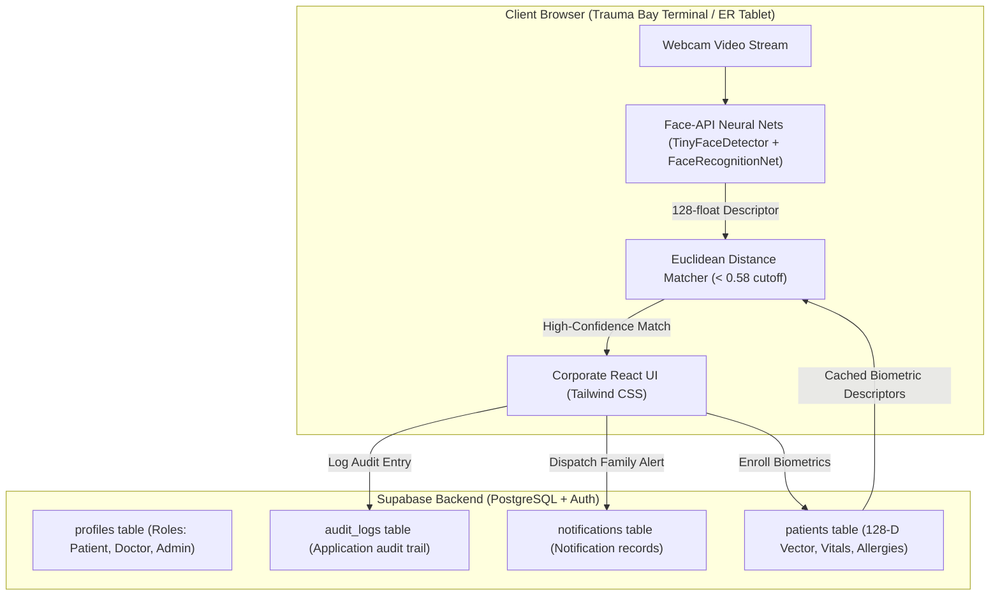

# MED ID — Emergency Biometric Health System
> **"Unconscious patient. A clearer path to care."**
> MED-ID helps authorized ER clinicians identify enrolled patients with face recognition or device passkeys. A verified scan reveals the patient's basic profile; access to the medical report requires super-admin approval.

---

## ⚡ Live Hackathon Demo Walkthrough (3-Minute Script)

### Step 1: Connect Supabase
1. Run the app: `http://localhost:5173/`
2. Click **"Connect DB"** on the top navigation bar.
3. Paste your **Supabase Project URL** and **Anon Key**.
4. Open your [Supabase Dashboard](https://supabase.com/dashboard) > **SQL Editor**, and paste the contents of `supabase_schema.sql` (also available via the **"Copy SQL Schema"** button in the app setup dialog).
5. Click **"Save & Apply"**. The status pill will turn **Green (Supabase Live)**.

The SQL script is also an upgrade script for the earlier demo tables. It creates the app's biometric, audit, and notification schema and migrates existing profiles. Doctors receive basic patient details after a verified scan, while medical reports require super-admin approval. Promote the first admin manually in SQL Editor, for example: `UPDATE public.profiles SET role = 'admin', status = 'active' WHERE email = 'your-admin-email';`. New doctor accounts remain pending until an admin approves them.

### Shared patient medical history

Patients can review their own scrollable medical history. Doctors can view and amend it only after super-admin approval; each doctor entry is stamped with the doctor's license number and hospital. Patients can edit personal and emergency-contact details but cannot change clinical records. The admin dashboard handles report approvals and does not show patient medical records. Existing deployments should apply the SQL migrations in `supabase/migrations/` before deploying the updated app; fresh setups can use `supabase_schema.sql`.

Doctor sign-up requires a license number and hospital name. Admin access is provisioned by an existing project administrator: update one trusted account in Supabase SQL Editor with `UPDATE public.profiles SET role = 'admin', status = 'active' WHERE email = 'admin@example.com';`, then sign in again. Admins can review report requests, doctor accounts, notifications, and audit activity; their dashboard has no ER scanner or patient dossier.

If signup returns HTTP 500, run `supabase/repair_auth_signup.sql` in the Supabase SQL Editor to replace the common legacy `on_auth_user_created` trigger with MED-ID's current profile trigger. If it still fails, inspect the matching **Auth** and **Postgres** entries in the Supabase Logs; Auth 500 errors commonly come from database triggers or constraints.


### Deploy the web app to Vercel

1. Push this project to a Git provider and import the repository in Vercel, or run `npx vercel` from this folder.
2. Use the Vite defaults: build command `npm run build` and output directory `dist`. The included `vercel.json` configures these values and rewrites app routes to the SPA entry point.
3. Add `VITE_SUPABASE_URL` and `VITE_SUPABASE_ANON_KEY` in Vercel **Project Settings → Environment Variables** for Production (and Preview if needed). The same names are listed in `.env.example`. Redeploy after changing environment variables.
4. In Supabase **Authentication → URL Configuration**, add the Vercel production URL and any preview URLs to the allowed site/redirect URLs.
5. Deploy with `npx vercel --prod` if using the CLI. Vercel builds the static app; Supabase Edge Functions remain deployed to Supabase.

### Deploy server-verified device credentials

1. Install the Supabase CLI and link this folder to your Supabase project.
2. Set production function secrets in **Supabase Dashboard → Edge Functions → Secrets** or with the CLI. For the current production URL, set `MEDID_RP_ID=med-id-zk.vercel.app` and `MEDID_ORIGIN=https://med-id-zk.vercel.app`; set `MEDID_SERVICE_ROLE_KEY` to the project's service-role secret. With the project linked, run `npx supabase secrets set MEDID_RP_ID=med-id-zk.vercel.app MEDID_ORIGIN=https://med-id-zk.vercel.app MEDID_SERVICE_ROLE_KEY=YOUR_SERVICE_ROLE_KEY` (replace the placeholder locally; never commit or paste the key into chat). Supabase supplies `SUPABASE_URL` to the Edge Function runtime. If you use a custom domain, use that exact host for the RP ID and its full HTTPS origin for `MEDID_ORIGIN`.
3. Deploy the verification function with `npx supabase functions deploy webauthn`.
4. WebAuthn credentials are scoped to the relying-party domain. A passkey enrolled on `localhost` cannot be used on the Vercel hostname, so patients need to enroll again after production configuration. Preview deployments on different Vercel hostnames also need a matching RP ID/origin configuration.

### Patient signup intake schema update

Before deploying the signup intake changes, run `supabase/migrations/20261120123000_patient_signup_intake.sql` in Supabase **SQL Editor**. This adds the demographic fields, generated MED-ID, and a one-time authenticated intake RPC. Medical intake is sent only after authentication and is not placed in Auth user metadata. Existing patient accounts are marked as already set up; new accounts complete intake after signing in if email confirmation was required.

The function authenticates the Supabase user, issues one-use challenges, verifies WebAuthn registration and assertion signatures, and returns only allowlisted basic profile details after verification. Never put the service role or secret key in the Vite `.env` file.

### Step 2: Live Patient Enrollment
1. Navigate to **"Patient Portal"** (or click "Sign In / Join" -> Select **Patient**).
2. Enter vital medical information:
   - **Blood Group**: e.g., `O- Negative (Universal)`
   - **Severe Allergies**: Add `Penicillin (Anaphylaxis Risk)`, `Latex`
   - **Chronic Conditions**: Add `Type 1 Diabetes`
   - **Emergency Contacts**: Add Name, Relationship (e.g. Spouse), Phone number
3. Click **"Enroll Face Biometrics"**:
   - The browser webcam activates with a guided facial oval.
   - Click **"Capture & Save Emergency Biometrics"**.
   - The browser extracts a 128-dimensional face descriptor; the Edge Function keeps enrolled templates private and compares scan descriptors server-side.

### Step 3: ER Doctor Quick Scan (The Live Trauma Test)
1. Switch to **"ER Scanner"** on the top navigation bar (or sign in as an **ER Doctor**).
2. Scan the enrolled patient's face or use a passkey authenticator available on the scanning device.
3. After a verified scan, the dossier shows the patient's basic profile and emergency contacts. Request the medical report if needed; a super-admin must approve it before clinical details are available. A doctor can send a WhatsApp alert to opted-in contacts once the Cloud API and approved template are configured.

### Step 4: Super Admin & HIPAA Forensic Auditing
1. Sign in to the admin account and open **Overview**.
2. Review pending medical-report requests and grant or deny access. A grant expires after 24 hours.
3. Manage doctor credentialing and review audit activity. The admin dashboard does not display patient medical records.

---

## 🏛️ System Architecture



### Key Technical Advantages:
- **Zero Cloud Latency for Neural Inference**: Facial detection and embedding calculation occur 100% on-device in the browser using WebGL/WASM. No external proprietary facial recognition API or paid cloud fees.
- **Biometric storage**: The app stores a 128-dimensional face representation and an enrollment photo in the patient record. The SQL setup applies patient and active-doctor row-level access policies.
- **Resilient Fallback**: If patient facial trauma prevents biometric matching, doctors can instantly fall back to Emergency Med-ID or Name search.

### Integration limits

- WebAuthn verifies a device credential; the operating system may use fingerprint, face, or device PIN, and the app cannot tell which method was used.
- WhatsApp Cloud API sends approved emergency templates through the hospital business number when configured.
- This project is a prototype. The browser face matcher and demo credentials are not a substitute for validated clinical identity systems or a security and privacy review.

## Biometric-gated medical reports and WhatsApp alerts

Apply the newest SQL migration before deploying the updated app:

```powershell
npx supabase db push
```

Deploy the updated Edge Functions:

```powershell
npx supabase functions deploy webauthn
npx supabase functions deploy face-match
npx supabase functions deploy whatsapp-alert
```

WhatsApp Cloud API messages are sent from the `whatsapp-alert` Edge Function. In Meta for Developers, connect a WhatsApp Business Account, add/verify its sending phone number, create and get approval for a Utility template named `medid_emergency_alert` (language `en`) with three body placeholders, and ensure next-of-kin have opted in to receive emergency messages. Patients must also tick the WhatsApp consent box in their MED-ID profile. Template body example: `Emergency alert: {{1}} is receiving emergency care at {{2}}. Attending physician: {{3}}. Please contact the hospital immediately.` The function sends this template to each number separated in the patient's next-of-kin phone field with commas, semicolons, or line breaks.

Set these server-side secrets in Supabase (never in Vercel or a browser `.env`):

```powershell
npx supabase secrets set --project-ref YOUR_PROJECT_REF WHATSAPP_PHONE_NUMBER_ID=YOUR_PHONE_NUMBER_ID WHATSAPP_ACCESS_TOKEN=YOUR_LONG_LIVED_SYSTEM_USER_TOKEN WHATSAPP_TEMPLATE_NAME=medid_emergency_alert WHATSAPP_TEMPLATE_LANGUAGE=en WHATSAPP_GRAPH_API_VERSION=v27.0
```

`WHATSAPP_PHONE_NUMBER_ID` is the WhatsApp Business sending number's ID in Meta, not its visible phone number. The access token needs WhatsApp Business messaging permission. Meta's Cloud API sends via the business phone number endpoint and supports approved template messages; template management is in the WhatsApp Business Account. [Cloud API send-message docs](https://developers.facebook.com/documentation/business-messaging/whatsapp/overview/) · [Template management reference](https://developers.facebook.com/docs/graph-api/reference/whats-app-business-account/message_templates/).

Doctors receive only an allowlisted basic profile after a server-verified face or device-authenticator scan. They can request medical-report access in the dossier; the super-admin approves or denies it from the admin overview. Grants expire after 24 hours. Report requests require a successful scan in the prior 30 minutes. The admin dashboard does not fetch patient records or biometric templates.

### Android and other mobile passkey authenticators

MED-ID uses WebAuthn passkeys rather than collecting fingerprint images. Current Android Chrome can request the phone's built-in authenticator, which may verify with fingerprint or the phone screen lock. The app now tries the built-in authenticator first and falls back to the browser's available passkey choices if its capability check returns false. Keep the site on HTTPS, use a current browser (Chrome on Android or Safari on iPhone), and configure the phone's screen lock and fingerprint first. If the browser still cannot offer an authenticator, try an updated Chrome browser rather than an embedded in-app browser.

After changing the frontend, rebuild and redeploy the Vercel site. The WebAuthn server was also updated to allow the browser-selected authenticator when the platform capability probe reports no built-in sensor, so redeploy the `webauthn` Edge Function too:

```powershell
npx supabase functions deploy webauthn
```
